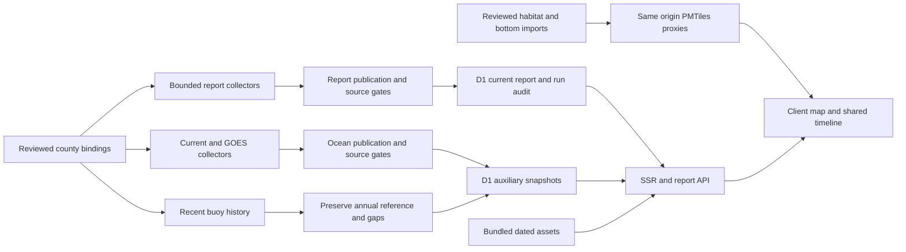

> **Historical archive (copied 2026-10-11, SkipperCast FE-62).** This is `docs/ARCHITECTURE.md` from the retired Fish (SLO Fish Report) repository at commit `68d7b44` (2026-10-06). It records how Fish worked and what was checked at the time, is not maintained, and may describe services, data and claims that no longer exist. SkipperCast's own documentation is the live truth: start at the [archive index](../../README.md) and [front-end design § 15](../../../../plans/front-end/design.md#15-retiring-fish). Links to Fish code, configuration or data that were not archived are shown as plain text, and identifiers that could not be published were redacted.

# Fish architecture

Status: actual local rebuild and future production operating design, October 1–2, 2026. One TypeScript codebase serves approved county hostnames; SLOFishReport.com is the first regional binding. Cloud resources, deployed schedules, distribution and browser acceptance are separate gates.

## Application and geographic contracts

Workers renders deterministic HTML; esbuild packages a small client with MapLibre/PMTiles and self-hosted assets. `src/state/experience.ts` holds county, area, fishing method, species, local calendar date, UTC selected hour, view and layer. Coast, Conditions and History share this state. Actual source clocks distinguish forecasts, predictions, observations, analyses, historical summaries and physical survey context. The report remains readable if interactive mapping fails.

`src/counties.ts` defines station IDs, three representative SLO forecast points, bounds, timezone, access notes and original links. The strict hostname registry rejects unknown hosts; only localhost and the configured exact `PREVIEW_HOST` use the controlled default county. `src/experience-config.ts` binds reviewed county shoreline, species habitat, history/ocean endpoints, bathymetry and map cameras. Neither arbitrary host text nor a query parameter determines an upstream URL. Monterey/Santa Barbara require reviewed local bindings; no repository clones or SLO-data fallback.

## Implemented pipeline



The hourly Cron (`17 * * * *`, UTC) requires `DB`. Without it, scheduled work skips and serving falls back to bundled dated assets. With storage, report and auxiliary jobs are scheduled separately. Production scheduling has **not** been witnessed. Optional R2 `EVIDENCE` archives normalized report/auxiliary attempts; raw evidence uploads, immutable full report history, job queues and distribution are future extensions.

### Collection, publication and storage

- `src/providers/index.ts` collects NWS forecast/alerts, NOAA buoys/tides, CDIP and county health, MUR and CDFW display boundaries. Units, native intervals, actual clocks and nulls survive normalization. Three forecast points do not resolve every beach or harbor.
- `src/providers/catches.ts` binds only SLO to the reviewed public SkipperCast Morro/Avila linked-fact feed. `CatchContext` records original feed generation, Fish receipt, report-window bounds, latest trip date and the pinned facts-only rights review. The adapter validates each dated trip against its independently fetched original publisher-day receipt; it is not an operator bulk-feed or AIS importer.
- `src/publication.ts` governs report publication and retained useful layers. Failed attempts remain audit evidence; collection time cannot refresh a retained observation/analysis. `scripts/refresh.mjs` publishes local SLO assets only.
- `src/providers/ocean.ts` consumes the fixed public SkipperCast regional NOAA intelligence feed and pinned NOAA GOES capability times. `src/ocean-publication.ts` supplies report-independent outage/retention decisions. Current model and observation contracts are in `src/ocean-types.ts`; source selection/gates in `src/map-sources.ts`.
- `src/providers/history.ts` parses discovered NDBC annual/recent schemas, missing sentinels and clocks; `scripts/refresh-history.mjs` performs checkpointed bounded annual backfill. `src/auxiliary.ts` refreshes only recent history in the Worker, preserving the reviewed seasonal reference and original receipt clocks.
- `migrations/0001_initial.sql` provides current reports, pipeline run audits, subscription and delivery scaffolding. `0002_auxiliary.sql` provides county/kind current ocean/history snapshots. Both are required for the complete provisioned Worker path; schema scaffolding is not functioning email delivery.
- `/api/report`, `/api/history`, `/api/ocean` read scoped D1 snapshots when available, otherwise corresponding bundled assets. `/api/health` evaluates **report** freshness/source state; it is not comprehensive proof that cloud/current/history layers or Cron work. Those need separate receipts and clock inspection.

## Source products and time gates

| Product | Implemented treatment and limits |
| --- | --- |
| NWS hourly forecasts / alerts | Native intervals expand to hour bins without extra precision; issue/fetch/coverage gates and relevant warning intervals. Selected local days stop at actual supported 72-hour coverage; day three is provisional. |
| NDBC observations | Actual measured time; three-hour freshness and future checks; absent variables remain null. Wave-only 46215 is not a local wind sensor. |
| NOAA tide predictions | Port San Luis 9412110 curve/events, MLLW and Pacific calendar/DST-aware display. Station tide stage is not Morro Bay entrance current or slack water. |
| CDIP nearshore points | Five named sites, native three-hour samples/quality masks; issue <48 h, retrieval <3 h. Nearest supported sample retains its actual time; not measured shorebreak. |
| County beach health | Factual official site status; sample dates unknown. Recent retrieval does not certify today's water contact. |
| MUR surface analysis | Native 0.01° sampled at 0.02°, complete requested lattice validation, land/lake/ice/fill masks and error retained; ≤72 h clock gate. Neither bottom temperature nor future SST. |
| WCOFS surface current | Native ~4 km/three-hour forecast frames, issue ≤36 h, retrieval ≤6 h; use supported native times only. Missing cells blank; no invented continuous trajectories or exact entry flow. |
| HF radar surface current | Native source resolution and sampling stride retained; retrieval/observation ≤6 h. Future selections withheld. Native 1 km data may be sampled every fourth cell, so display spacing is not 1 km. |
| GOES longwave imagery | Explicit acquired time ≤90 min, pinned WMS tiles and short observed-frame loop. Current-day observation only; not cloud-cover percentage, a forecast or dive visibility. NWS hourly sky-cover percentages are a separate forecast series. |
| Recent / seasonal history | 45-day measured UTC-hour means and pooled month quantiles/counts from advertised annual archives. No invented gaps, catch model, forecast bias correction or standard 30-year climatology. |
| Linked local catch facts | Feed and independent original publisher receipts ≤72 h, no more than five minutes future skew; exact date/URL/original-record matching and conflict/duplicate gates. Parse at most a 30-day reviewed window, display past seven local days. Trip date is not publisher-fetch or Fish retrieval time. |
| CDFW boundaries | Full count-matched DS582 geometry, source age gate and CC BY 4.0. Display context is separate from current date/species/method eligibility. |

`src/daily.ts` uses the actual clock to gate freshness, then filters the selected local calendar day; future selection does not age a current source at a fabricated future retrieval time. Today may retain the current prior-hour forecast bin. Future days never reuse today's buoy temperature as a forecast. DST days preserve their actual 23/25-hour tide/calendar span. Source outages and relevant warnings suppress qualified conditions windows. Thresholds remain low-confidence editorial exposure filters, not bite probability or safety clearance; visibility remains unknown without an actual in-water report.

## Physical context and species opportunity

1. **Context geography:** same-origin CUSP line extract retains NOAA creator, historical date and accuracy properties; its z12 display quantization is approximately 8 m, not a 2 m shoreline. It is not a land polygon or legal/current tidal boundary. NAIP-only dated aerial tiles give sharper land context with offshore gaps; generalized Natural Earth is an overview mask.
2. **Native bottom:** read-only approved USGS cache COGs produce original-grid depth colors for nominal 0–300 ft, native masks/transparent gaps, nearest display sampling and qualified relief. The fixed ≤16 MiB `/api/bathymetry/tiles` contract SHA-verifies one archive and serves closed/suffix ≤2 MiB ranges. No expiring fishing-permission gate is applied to historical public-domain physical measurements. Unknown datum, producer interpolation uncertainty and deeper producer 5 m resampling remain explicit.
3. **Reef habitat:** reviewed SkipperCast import uses public-domain USGS original contributors, complete screened polygons and four species proxies. Two archives have 2,868 habitat features; 43 exact curated features provide a detail subset. Ordinal species fit 2/3 colors, terrain grade and bathymetry colors are separate. The live proxy validates approved rights/version, ready/unexpired upstream screen and pinned ETag/range metadata. Manifest validation lasts at most five minutes; changed releases fail closed.
4. **Shore opportunity:** NOAA ESI 2006 fine/medium sand geometry and factual CCC public approaches support four named beaches. Surfperch/halibut logic combines source/rule/access clocks, whole-geometry protection checks, fresh applicable conditions and explicit regional timing context. Priority is ordinal planning context, never catch probability. Current bars, troughs, breakers, fish presence and complete legal/access eligibility are unmeasured.

Native bottom coverage remains partial, mainly Point Buchon/Port San Luis through Morro Bay/Point Estero. No countywide survey is implied by region labels. Original USGS releases with collaborating CSUMB attribution are distinct from excluded standalone commercial-restricted CSUMB products. Rights must be reviewed per original producer and contributor, not inferred from NOAA delivery or publicly working URLs.

See [product/source research](PRODUCT-DESIGN-RESEARCH.md), [bottom contract](BATHYMETRY-OVERLAY.md), [habitat bridge](SKIPPERCAST-BRIDGE.md), [shore model](SPECIES-OPPORTUNITY.md) and [history pipeline](HISTORY-PIPELINE.md).

## Reviewed catch-fact display

The public SkipperCast `data` branch Morro/Avila feed is separate from the `conditions` branch ocean-intelligence product. Its reviewed factual-count scope is pinned to catalog commit `a481da68923649db6fda277af4bd6f40813f6436`, September 21, 2026. The source audit observed 74 dated trips with latest September 28; this is a dated feed outcome, not a promised current display count. [Reviewed binding evidence](../research/reviewed-catch-binding.md) records the scope and original-source checks.

Collection has a fixed URL, 12-second timeout and 3 MiB body cap; redirects/non-200 responses fail. Schema/region/date window, allowed ports, factual labels, nullable anglers, nonnegative counts, explicit disposition and exact publisher/date URLs are validated. A fresh feed wrapper cannot refresh a stale or failed publisher-day receipt. Rows must match that original receipt exactly. Exact duplicates are ignored; conflicting identities are excluded. Independently valid rows may survive partial failures, with exclusions reported. Missing categories/reports never establish zero catches.

`src/ui/catches.ts` shows a **boat-only briefing** and dated trip modal: past seven local calendar days, maximum eight cards, each with original publisher link. Modal access from the source sheet does not turn these into shore or dive evidence. Historical trip dates are independent of the selected forecast day. Unmarked counts remain **reported**, not assumed retained; release/retention labels are shown only as supplied. Bars compare species counts within a trip, not abundance or success odds. Landing port and optional broad reported ground do not identify a specific catch point; no catch pins or species probabilities are created.

This implemented narrow factual display does not authorize creative content/photos, full page republication, licensed bulk operator feeds, or AIS movement/location inference. Those require separate rights, identity, coverage and validation work described in [charter intelligence](CHARTER-INTELLIGENCE.md). Catch totals never alter physical habitat fit, shore timing or dive conclusions.

## Refresh and review boundaries

```sh
npm run refresh
npm run refresh:ocean -- --county=slo
npm run refresh:history -- --max-files=80 --concurrency=2
```

The history package command includes `--all-years`; annual SHA checkpoints make retries/resumes bounded. `--revalidate` explicitly checks corrected original archives. Production hourly work refreshes recent data only, not decades of annual files. Reviewed shore/habitat/native-bottom imports are separate offline jobs described in README and their contracts. A successful import does not automatically renew dated legal/access reviews.

The client rechecks its actual clock every minute and refreshes report/ocean/history/shore products every ten minutes. Provider failures retain original clocks; stale layers hide or become explicit unknowns. MUR/MPA source updates follow their data clocks, and GOES playback shows its displayed acquisition time. These source-reviewed behaviors have not been accepted through live browser interaction.

## Distribution and expansion

Email remains disabled pending dedicated sender, double opt-in, preference and unsubscribe/suppression tests. Weekly editorial/Instagram are future source-grounded drafts requiring approval until platform/auth/output validation. No generic iMessage broadcast integration is promised. Future queues must enforce report validity, consent, suppression, idempotency and reconciled send outcomes.

Keep access free and label any eventual paid placement `Advertisement`; sponsorship cannot change condition grades, species/habitat priority or source selection. Commercial harvest recommendations require independently reviewed commercial rules. Licensed bulk catch reuse and charter AIS are separate future pipelines; the existing small reviewed trip facts are not successful-fishing pins or evidence inferred from slow vessel movement.

A new county needs its own hostname/config/source rights, representative stations, physical coverage, exposure/access, species/method/current rules and quality checks. Native-bottom proxy allowlists and regional imports must be extended deliberately. Live mobile/desktop visual QA, resource provisioning, deployment and witnessed scheduled operation remain acceptance gates; see [launch](LAUNCH.md) and [independent review](INDEPENDENT-REVIEW.md).
