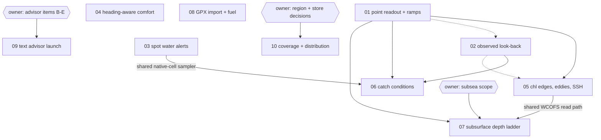

# SkipperCast build specs (for the Hermes build agent)

Prepared 2026-11-19 (PT) against `github.com/Grahammmm/skippercast` at commit `fa9c358` (v0.8). This index follows the **rea spec method** (`github.com/morluto/rea`, `docs/development/documentation.md` → *Feature lifecycle*). Each feature has its own directory with `spec.md` (problem, desired behaviour, requirements, acceptance, non-goals), `plan.md` (the single implementation plan, contracts and architectural choices) and `tasks.md` (incremental, testable steps linked to requirements, plus a dated Verification section to fill in). This README is the roadmap: it lists only the child specs, their order and their dependencies. Requirements live in each child.

For convenience, each spec is also concatenated into one file, `NN-slug.md`, generated from the three files. **Edit the directory files, not the concatenation.** `specs.json` is the machine-readable index.

Every spec opens with **Intended goal → Purpose → User journey → Use cases**, then the build detail. The specs are self-contained: a coding agent with the repo and this folder needs nothing else.

## Index and build order

| # | Spec | Goal (one line) | Priority | Effort (estimate) | Depends on | Owner gate | Files |
| --- | --- | --- | --- | --- | --- | --- | --- |
| 01 | Full point readout and adjustable colour ranges | One tap lists every layer's value with its source and age; the water-temp ramp can fit the view or be set by hand | 1 | S | none | no | `01-point-readout-and-ramps.md`, `01-point-readout-and-ramps/` |
| 02 | Look-back playback for observed layers | Step back 7 days of SST, fronts and chlorophyll on the time dock | 2 | M | 01 (soft) | no | `02-observed-lookback.md`, `02-observed-lookback/` |
| 03 | Water-condition alerts on saved spots | Push when the water at a private saved spot meets the user's condition; new-analysis alerts | 3 | M | none | no | `03-spot-water-alerts.md`, `03-spot-water-alerts/` |
| 04 | Heading-aware comfort and calibration | Ride-by-heading rose for out/back runs; verdicts calibrated from the owner's comfort reports | 4 | M | none | no | `04-heading-aware-comfort.md`, `04-heading-aware-comfort/` |
| 05 | Chlorophyll edges, eddies and SSH | Colour edges, model eddies and sea-surface height beside the existing SST fronts | 5 | M | 01; 02 (soft) | no | `05-chlorophyll-edges-eddies-ssh.md`, `05-chlorophyll-edges-eddies-ssh/` |
| 06 | Conditions recorded with each catch | Private conditions snapshot on every catch-log entry, plus "my patterns" | 6 | M | 02, 03 (sampler), 01 | no | `06-catch-conditions.md`, `06-catch-conditions/` |
| 07 | Subsurface depth ladder | WCOFS temperature at 0–100 m, thermocline, mixed layer, salinity | 7 | L | 05, 01 | **yes**: confirm "subsea weather" | `07-subsurface-depth-ladder.md`, `07-subsurface-depth-ladder/` |
| 08 | GPX import and fuel estimate | Import chartplotter waypoints into saved spots; opt-in fuel estimate in the Boat brief | 8 | S | none | no | `08-gpx-import-and-fuel.md`, `08-gpx-import-and-fuel/` |
| 09 | Text Advisor launch | Run the owner's launch sequence for the built advisor | 9 | S (engineering) | owner items | **yes** | `09-text-advisor-launch.md`, `09-text-advisor-launch/` |
| 10 | Coverage and distribution | Second active region (per the existing costed plan) and a store-listed wrapper | 10 | L | owner decisions | **yes** | `10-coverage-and-distribution.md`, `10-coverage-and-distribution/` |

Effort labels are estimates: S is days, M is weeks, L is a month or more of agent work plus review.

## Dependency graph

Plain-text order for parallel lanes:

- **Lane A (map):** 01 → 02 → 05 → 07 (after the owner confirms 07's scope).
- **Lane B (account and server):** 03 → 06 (06 also needs 02).
- **Lane C (boat):** 04 and 08, both independent.
- **Owner-gated:** 09 and 10 run when the owner acts. The agent prepares and then stops.

## Ground rules for every spec (from the repo)

- Follow `AGENTS.md`: one task is one branch and one PR. Never push to `main`. Rebase on fresh `main`. Get an independent review. AGENTS.md names `codex/` and `claude/` branch prefixes, so ask the owner whether Hermes should use `hermes/<task>`.
- Generated files: change the source, then rebuild (`AGENTS.md` table). Client strings are authored only in `catalog/app/strings.json` (English and Spanish), then `node scripts/build_landing_strings.mjs`.
- Map layers follow the layer-card rules in `web/map/layers.ts`: legend, a basis sentence naming product, grid and age, attribution, time tag, and an age limit past which the layer is withheld. Never interpolate across gaps, never gap-fill, and never claim catch odds (`docs/evidence-ladder.md`, `docs/conditions-model.md`).
- Private data (saved spots, catch log, comfort feedback) never reaches a public route, feed, preview, analytics point or log line.
- Before each PR, run what CI runs (`AGENTS.md` → Before opening a PR): `pnpm typecheck`, `pnpm build`, `node scripts/check_client.mjs`, `node --test tests/test_*.mjs`, `node scripts/check_copy.mjs`, `python -m pytest -m "not gis"`, `python scripts/check_repository.py` and `python scripts/check_web.py`.
- Record the dated verification in each `tasks.md`.

## Data inputs

Every spec names its inputs. Specs 01–06 and 08 use only sources SkipperCast already reads (NOAA CoastWatch Geo-Polar Blended SST, NOAA VIIRS OCI chlorophyll, NOAA WCOFS, GFS and GFS-Wave via the existing feeds, NOAA tides). Spec 05 (`zeta`) and spec 07 (`temp` and `salt` on 41 levels) use extra variables of the WCOFS regular grid already read for currents (DDS checked 2026-11-19). The data-source inventory is at [docs/research/data-sources/](../data-sources/README.md), with per-source endpoints and download steps in `sources/`. Sample pulls were made on 2026-11-19; those sample files are not in the repository. Specs 05 and 07 name them as optional alternatives.

## How rea was used

1. `rea` (REA: Reverse Engineer Anything, `rea-agents` 6.9.0 from npm, the official package named in the repo README) was cloned on the research box to `/workspace/skippercast/rea` (that checkout is not in this repository) and installed (`npm install --global rea-agents@6.9.0`; Node 24.22.1). `rea doctor` reported the native engines (Hopper, Ghidra, IDA) missing. Those are needed only for binary analysis.
2. **The spec format comes from rea's own spec method**: `docs/specs/README.md` and `docs/development/documentation.md` → Feature lifecycle (spec.md / plan.md / tasks.md per feature, a roadmap that only indexes children, numbered requirements, tasks linked to requirements, and dated verification).
3. **rea's tool was used for its intended purpose**, investigating a competitor feature from shipped artifacts. `rea analyze-web-bundle` ran over a local headless Chrome (CDP on 127.0.0.1) against the public, unauthenticated pages `fishare.app/offshore-pro` and `fishorpass.com/how-it-works`. The evidence bundles are in `rea-evidence/`. **Result:** no feature-relevant findings. Fishare's page exposed only `/api/pageview`. The Fish or Pass scripts hit rea's 30 s per-script analysis deadline, and no endpoints were recovered. The competitor features themselves sit behind sign-in (`saltyoffshore.com/app` redirected to `/app/login`, so analysis stopped there; no login was attempted) or in native iOS/Android apps, which need app binaries plus a decompiler that isn't installed. The specs are therefore grounded in the SkipperCast repo and the competitor's public descriptions, not in reverse-engineered competitor code. No competitor code or data endpoint is used in any spec.
4. In line with rea's own guidance ("Skip REA for ordinary source-repository architecture analysis"), the SkipperCast repo was read with normal tools, not rea.

## Corrections to the competitor analysis found while speccing

- Tap-to-read already exists for water temp, contrast, currents, fronts and swell (`web/map/chart.ts` `fieldReading`, one reading at a time). Chlorophyll and wind have none, and the ramp isn't user-adjustable. Spec 01 is scoped accordingly.
- The brief already shows the window's worst hour (`brief.worst` string). It was dropped from spec 08.
- A GPX waypoint reader exists (`web/gpx-waypoints.ts`) but isn't wired to any UI. Spec 08 wires it.
- Comfort feedback already records `heading`, `phase`, `wind`, `sea` and `period` (`server/routes/feedback.ts`). Spec 04 uses it.

## References bundled with the specs

- Map inspiration: [skippercast_inspiration.md](../inspiration/skippercast_inspiration.md) and [skippercast_inspiration.json](../inspiration/skippercast_inspiration.json), plus [palettes.json](../inspiration/palettes.json), [cmocean_stops.json](../inspiration/cmocean_stops.json) and the images beside that file. Specs cite `docs/research/inspiration/skippercast_inspiration.json`.
- Competitor analysis: [competitors.md](../competitors/competitors.md) and [competitors.json](../competitors/competitors.json). Screenshots are not in the repository; see the package limits in [../README.md](../README.md#package-limits).
- [references/README.md](references/README.md) points at those folders.
- `rea-evidence/`: rea web-bundle evidence for the two competitor pages analysed. The bundles keep the path they were written to on the research box.

This folder is already in the repository. Paths in the specs are from the repository root (`docs/research/...`, `web/...`, `catalog/...`).
