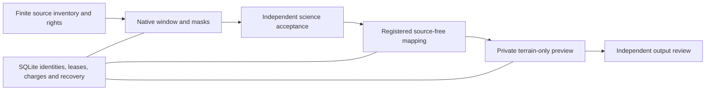

# Shared coastal pipeline contract

The implementation is `skippercast.coastal`. Use the reviewed package and existing approved environment under the repository dependency policy. Skill scripts are compatibility entry points, not separate scientific implementations. Package resources include schemas and the pinned whole-ping GSF adapter. Do not install services or change isolation, access, credentials or model routing as part of a run.

## Evidence and stages

The host coordinator stores geographic EPSG:3310 segments in SQLite, with fenced leases and input/code/dependency/parameter identities. Asset hashes identify bytes, not geographic segments. A bounded invocation is a command, not a persistent service:

```sh
python -m skippercast.coastal.cli --root REPO --db var/coastal/coordinator.sqlite status
python -m skippercast.coastal.cli --root REPO identity
```

These inspection commands do not create a queue, enqueue, recover or dispatch
workers. Identity reports actual imported code and packaged schema bytes,
distribution metadata when present and dependency versions when available. It
does not certify an installed wheel, native-library usability or real output.
Keep its machine-local paths in the private run receipt. A source-checkout
invocation is not installed-package acceptance.

The coordinator's existing dedicated source-free launcher is
`python -m skippercast.coastal.coordinator.source_free`; its command syntax and
preconditions are described in the [private terrain runbook below](#private-terrain-runbook).
The generic `coastal.cli enqueue` and `coastal.cli run` examples formerly shown
here had no matching module and are not execution routes. Use a reviewed,
bounded run specification and the current policy before enqueueing. Preserve the
mission allowance across retries. The fixed stage dispatcher accepts
authenticated job files; never introduce caller-supplied executable commands.
An expired lease is not proof that its process stopped. Resolve uncertain
process identity before retrying.

The initial coordinator lane is `discover -> acquire -> qualify -> map -> render`. Here discovery inspects a supplied frozen local catalog; acquisition verifies existing cached bytes. Receipts must say that no external request or transfer occurred. External finite discovery/acquisition use the existing host-side bounded discovery procedure and approved endpoints; the isolated worker remains network-restricted. Do not label cache reuse as a new public search or imply all catalogs were examined.

A mapping-input v2 producer reopens native data and binds the bounded window, geographic support, metadata, rights, implementation and dependencies. Its verifier recomputes facts. Independent review is a separate byte-bound attestation with identity and expiry; it is not cryptographic proof of independence and cannot override a scientific hold. Never author factual observations merely to make readiness pass.

Source sign, units, datum and scale/offset are explicit. BAG elevation storage is positive-up even when a depth coordinate axis is down. Normalized terrain is positive-down metres with scale/offset already applied; do not negate it again. Unknown or conflicting semantics stay held. Preserve nodata and unsupported holes. BAG node footprints do not demonstrate continuous measurements between nodes. Derivatives require supported native spacing and geometry.

Render v2.1 distinguishes private-preview readiness from website acceptance. It requires supported terrain, rights-cleared imagery, numeric alignment with source-bound independent correspondence evidence, and separate review. Coordinate transforms alone do not prove image alignment. Geometry and texture must preserve unsupported regions; interpolation between observed nodes is visualization, not newly measured terrain. Missing imagery holds this paired-imagery lane. A separately assigned data-only
terrain preview follows its reviewed terrain-only contract and keeps imagery,
habitat and website acceptance separate.

## Runtime and preflight

Use the shared bounded runner: an independent supervisor, process identity and actual cleanup enforce deadlines. An environment variable or written deadline alone is insufficient. Keep unavailable model usage unknown and accounting conservative when receipts are incomplete. Preserve immutable bounds and stop on uncertainty instead of resetting reservations.

The historical `skippercast.coastal.hermes_preflight` example has no module in
the accepted source tree. Do not invoke it or treat a substitute command as a
passed preflight. An optional agent gateway is not required for the standalone
source-free route. Host imports, fixture reads, cancellation and artifact
roundtrips establish only host evidence. Actual protected gateway invocation and
external artifact return, when requested, need evidence from that runtime and
the applicable explicit approval. Keep the durable coordinator outside a
temporary gateway. A caller-provided context label cannot establish readiness.

## Trial and audit

Finish implementation, independent correctness/science review and any
applicable explicitly requested security review before a timed trial. Do not
start an optional security workflow merely because a private terrain task exists. First run a synthetic dataset through discovery, mapping and actual rendering, retaining deliberate mask holes and known alignment offsets. Label synthetic review packets and fixtures; never reuse them for a real source. Check every prerequisite for each authorized bounded real stage. If a gate is missing, save the hold and stop that dependent stage; do not replace evidence with a manually written receipt.

Record exact head, source/dependency identities, stage attempts, effective bounds, actual/unknown usage, outputs, independent review, cleanup and next action. Keep private receipts and bulky data outside version control. Private preview does not authorize merge, public upload, website integration or deployment. Skill corrections belong in a separate reviewed implementation revision, not in a running timed mission.


## Operating modes and bounded trial lessons

Choose a mode from the owner's requested output, and retain all its real gates:

| Mode | Required evidence | Separate downstream scope |
| --- | --- | --- |
| Private data-only terrain | Exact source/window, valid paired support, resolved storage/normalization semantics, geographic checks, private-use rights and independent science/artifact review | Imagery, habitat interpretation, rankings, fishing export and publication are optional only when requested |
| Paired terrain/imagery | Reviewed terrain plus imagery rights, independent numeric correspondence and the paired contract's review | Coordinate transforms alone cannot establish alignment or website acceptance |
| Habitat or publication | Requested interpretation/ranking and the applicable source, screening, rights and release contract | Terrain alone establishes neither habitat/substrate nor public permission |

Nominal MLLW with unknown realization stays explicitly nominal; do not invent a
realization, uncertainty calibration, VDatum transform or navigation claim.
Unknown datum realization differs from unresolved sign/units/scale semantics,
which must still hold normalization. Source positive-up BAG elevation and
normalized positive-down depth are different fields; never apply the sign twice.

**Check geometry before source admission.** A historical interest/hard-bottom
polygon is a study constraint, not NOAA's exhaustive bathymetry coverage. Its
failure to cover a proposed square does not prove source nodata. Use retained
actual affine, grid dimensions, native cell outer bounds and full or independently
reviewed conservative geometry (including holes) to test every window and margin
without reopening source arrays. Compare proposed area to the study polygon's
capacity before promising a contiguous square. If a different contained or
disjoint configuration is authorized, pin it as a distinct finite profile; never
relax a geofence, substitute its bounding box or relocate windows silently.

**Admit the complete stage, then launch.** Preparation must return success and
validate exact packet count/order/window membership, producer references,
independent reviews, code/dependency pins and the stage's resource envelope.
Failed preparation means do not launch, even when a downstream count guard would
refuse it safely. The reviewed strict bounded BAG profile requires every
side-squared raw/mask/source/normalized pair and its depth/uncertainty criteria;
missing one pair remains a factual hold. Synthetic tests and metadata alone do
not establish actual support. Independent review of registered observations and
qualified arrays remains separate from worker completion.

**Keep resource scopes distinct.** Preserve the old charged ledger and all
original receipts. An explicitly new source-volume grant is not a refund or a
physical-I/O quota. Record original source bytes streamed/hashed, sealed-copy
hashes, logical pair visits and retained regular output bytes separately, with
unknown physical I/O/disk-quota measurements left unknown. A 64 MiB output cap
cannot stand in for a source-read allowance. Reserve the complete retained stage
tree before dispatch and audit it before result commitment. A 60-minute stage or
combined acquisition/qualification ceiling is not padding: use its original
immutable mission clock, stop when the finite batch ends and authorize no extra
phases merely because time or allowance remains. Report service-unit elapsed time,
worker-supervised time and review/coordination elapsed separately.

**Measure from existing artifacts.** Verify prior/current support hashes and
compute native-grid or consistently projected mask unions without new source
acquisition or a code change solely to claim growth. Deduplicate old/new windows;
prove zero overlap rather than assuming it. Report nominal native-cell area and
equal-area projected area with their method/tolerance. Disjoint measured cores
supply neither the area of their bounding box nor continuous seam/context support.
A schema fix, pretty image or successful job adds no measurement by itself.

**Preserve provenance through source-free recovery.** Validate the original full
BoundCRS source/target/operation first, then canonicalize the physical projected
CRS of derived acceptance packets when needed by the consumer. Preserve the
original CRS, hashes and unchanged rasters; do not infer a vertical transformation
from a representation fix. Archive immutable failed plan/unit/output receipts
before a distinct bounded recovery using retained qualified artifacts. Do not
edit the frozen native export, reset native charges or reopen the source to repair
a derived metadata/preparation error.

**Name the next actual milestone.** A local catalog stage proves local inspection,
not live official discovery. A private native/map/render trial proves only its
selected artifacts. The next coordinator/producer milestone needs a real bounded
registered handoff and durable recovery evidence; the next map-loader milestone
needs actual support-hole/disjoint-core preservation; the next browser milestone
needs interaction, camera and performance evidence beyond static PNG inspection.
Continue independent authorized source-free work through an unrelated optional
habitat/imagery hold, and stop the dependent stage at a genuine missing gate.
Authenticated native execution can deliberately forbid automatic successors;
separately launched mapping/render controls do not prove an integrated coordinator
pipeline. Audit legacy native adapters for their own sign/datum behavior rather
than inferring they inherit authenticated-worker normalization.

These lessons come from completed bounded real-data and source-free recovery
receipts. Keep their exact paths, hashes, dates, failed-attempt evidence and scope
in the private self-audit/run receipt; examples do not grant current execution,
installation, deployment or publication authority.

## Contributor handoff and production acceptance

The intended experience is a useful, reproducible private terrain preview from
reviewed source cells: choose a finite region, retain the source's real spacing
and holes, qualify depth and uncertainty, map only accepted support, then inspect
the rendered cores at a fixed camera. Discovery leads do not become measured
terrain automatically. Terrain does not establish habitat or paired imagery.
Public fishing layers, interactive website behavior and publication retain their
own contracts.

All three definitions already live under `skills/`:
`skippercast-discover-coastal-sources`, `skippercast-map-coast` and
`skippercast-render-coast-3d`. Reuse their existing references and helpers rather
than creating a second skill bundle. The versioned Mapping definition also
links `references/source-preparation-and-trials.md`; qualify that reference when
comparing an installed skill to the repository.



The host owns durable state; the fixed dispatcher runs bounded workers. An
accepted native producer can supply a registered retained qualification to the
source-free bridge. That bridge must preserve original-source isolation and
science/review lineage. This is architecture, not evidence that an integrated
production mission has run.

### Current proof and missing evidence

At accepted source `1a450b9866081a17be54aea5673b2f1de53f019f`, the prior
[PR657](https://github.com/Grahammmm/skippercast/pull/657) integration and
[PR660](https://github.com/Grahammmm/skippercast/pull/660) terrain-only admission
repair are reusable. Their retained reports describe 54 tests/65 subtests and
32 synthetic/admission cases respectively. Those reports do not establish the
current installed package, immutable real-data bundle or completed real render.
Site CI and deployment are separate evidence. Current skill lessons acknowledge
bounded real-data/recovery work; recover its actual immutable receipts rather
than denying it or promoting prose to production acceptance.

| Dependency task | Deliverable and inputs | Acceptance and authority |
| --- | --- | --- |
| COAST-PROD-01: inspection interface | `coastal.cli` status/identity and `tests/unit/test_coastal_cli.py`, using existing queue/schema/code identity contracts | Temporary synthetic queue retains held attempts and charges; absent/corrupt/escaping inputs fail honestly. No worker launch. Independent exact source review and normal PR checks precede integration. |
| COAST-PROD-02: installed closure | Existing package/wheel/build receipt, exact dependency and skill hashes, packaged resources and supported launcher identity | Compare actual installed consumer and canonical/declared-root positive plus traversal/symlink/hash/byte-cap negative receipts. Source-checkout inspection is insufficient. Missing environment or installation is a separate qualified task, not an implicit install instruction. |
| COAST-PROD-03: recover retained real inputs | Existing mission/checkpoint, window/affine/CRS, masks, raw/normalized pairs, derived outputs, rights and complete charged ledger | Original producer supplies immutable locators/hashes; no source reopen or reacquisition to reconstruct missing records. Science owner supplies the corresponding independent attestation. Keep unavailable evidence unknown. |
| COAST-PROD-04: private handoff | Accepted native producer/result identity and exact source-free plan, registered arrays and terrain-only input/review | Independent science/artifact review covers support, sign/scale/units, nominal datum, geography, uncertainty and the requested context/horizon. Imagery is optional for this explicitly terrain-only scope. Preserve genuine holds. |
| COAST-PROD-05: real preview | Same accepted terrain bytes, pinned loader/renderer and finite private output reservation | Actual output proves holes/disjoint cores, geography and depth; independently inspect fixed-camera preview. Existing exhausted native/provider/render operations are not renewed by source preparation or these docs. Execution needs its applicable bounded authority. |
| COAST-PROD-06: integrated operations | Same mission/queue identity, accepted stage outputs, original charges and supervisor evidence | Demonstrate idempotent resume, interrupted-worker recovery, child cleanup, artifact return, observable held/failed states and complete cost/usage bounds. Preserve uncertain processes and terminal failures. Public/paired website acceptance follows separately. |

Use these task IDs in contributor issues and PR descriptions. They are dependency
labels, not already-open issue numbers or assigned authorizations. Existing
reviewers and publisher serialize exact scopes; this document grants neither
account access nor a new retry allowance.

### Private terrain runbook

1. Recover original immutable receipts before any run. Match the native producer,
   source-free mapping plan and independently accepted terrain-only packet to the
   same window/support identities. Keep actual storage paths and precise private
   geometry outside Git. Do not infer support from a survey envelope or sum
   overlapping windows.
2. Inspect code/package identity and the existing queue using the commands above
   in the already-qualified environment. `metadata_found: false`, missing native
   dependencies or a mismatched skill/entrypoint remains a qualification gap.
   Record source-checked, packaged, installed and runtime-accepted separately.
3. For a separately admitted retained source-free mission, the existing launcher
   accepts `--root ROOT --database ROOT_RELATIVE_DB status`; its `import`
   operation requires `--source-root`, `--source-db`, `--plan` and
   `--deadline-epoch`; `enqueue` requires `--manifest` and `--index`; `run`
   requires `--deadline-epoch` and an explicit finite `--max-jobs` of at most
   three. These are syntax references, not instructions to launch a held mission.
   Do not point a new command at an old exhausted queue to create fresh attempts.
4. Keep the accepted original database/output receipts closed and recoverable.
   The existing source-free import/recovery contracts reject unresolved WAL or
   journal state and require producer/result and stopped-process proof. An
   uncertain worker is not retried merely because its lease expired.
5. Preserve masks, raw/normalized lineage, uncertainty semantics and nominal
   datum limitations. Render only the explicitly accepted slices. Record the
   preview and independent review; a PNG alone does not prove interaction,
   cgroup containment, reboot recovery or installed equivalence.
   The existing private preview module is
   `python -m skippercast.coastal.render.terrain_only`, with required `--root`,
   `--acceptance` (the independently accepted JSON packet) and `--output-dir`
   arguments. Its optional `--context-only` only prints a review context; it
   neither approves science nor renders. Prepare the exact packet and review
   horizon before any separately authorized preview. A standalone map followed
   by a standalone preview is not an integrated coordinator acceptance run.
6. Retain original charges and immutable failed receipts. Roll back a proposed
   source change by omitting/reverting that reviewed delta, never deleting source
   originals or resetting a terminal mission. Review current state before any
   supported recovery. Do not deploy a data preview as a public map.

### Reproducible synthetic inspection checks

In the existing approved Python 3.11+ test environment, the focused suite is:

```sh
python -m unittest -f tests.unit.test_coastal_cli
```

It uses only temporary synthetic queues, existing package resources and module
inspection. It never dispatches native, mapping or rendering jobs. It also
checks the module entrypoint from an artifact directory. Running it against a
source checkout proves that mode only; it does not build/install a wheel or
establish native rendering. The normal PR suite still applies. No dependency
installation or new CI workflow is introduced here.

### Public evidence manifest and source retrieval

Publish code, synthetic fixtures, evidence summaries and public PR/run links.
For a real-data handoff, record source identifier and official retrieval URL,
retrieval date, reviewed rights, expected byte count/hash, producer code and
dependency pins, window/support identity, normalized output hashes, review
identity/context/validity and original charge totals. Separate reported values
from locally byte-verified values. Never commit credentials, exact private cache
locations, restricted datasets or sensitive operational details.

For example, the retained public-source assertion for NOAA H13323 identifies
`H13323_MB_VR_MLLW.bag` at
`https://data.ngdc.noaa.gov/platforms/ocean/nos/coast/H12001-H14000/H13323/BAG/H13323_MB_VR_MLLW.bag`,
with reported source SHA256
`a7a10f65bed5ad18d06711ec30f935d373a3ec7c8a0d09f24e177721d36ba96c`.
This is a retrieval/hash reference, not a download instruction, a current rights
review or an independently verified window/output. Large source bytes stay in
the approved private artifact store; authorized contributors obtain them through
the owner-approved retrieval route. Missing receipt fields remain missing.

The following source-preparation manifest binds the focused synthetic check only.
Its source hashes can be compared with the owning PR; it contains no private run
locators and makes no real-data acceptance claim.

```json
{
  "schema": "coastal-source-preparation-evidence-v1",
  "date_utc": "2026-10-18",
  "accepted_base": "1a450b9866081a17be54aea5673b2f1de53f019f",
  "source_files": {
    "src/skippercast/coastal/cli.py": "8e18b824d98568b858722eef45eb292883f8c0d5ae5f274ca58c476f9e95fe2e",
    "tests/unit/test_coastal_cli.py": "ceffc584a478f092f03e856bc8b2fb083a5aa55eb9220693a9a1c2e5dc331d95"
  },
  "focused_check": {
    "command": "python -m unittest -f tests.unit.test_coastal_cli",
    "python": "3.11.16",
    "mode": "source-checkout; not an installed distribution",
    "tests": 12,
    "result": "PASS",
    "worker_dispatches": 0
  },
  "installed_package_acceptance": "UNVERIFIED",
  "native_acceptance": "NOT_RUN",
  "render_acceptance": "NOT_RUN",
  "authority": "source preparation and synthetic checks only; no exhausted cycle renewed"
}
```
